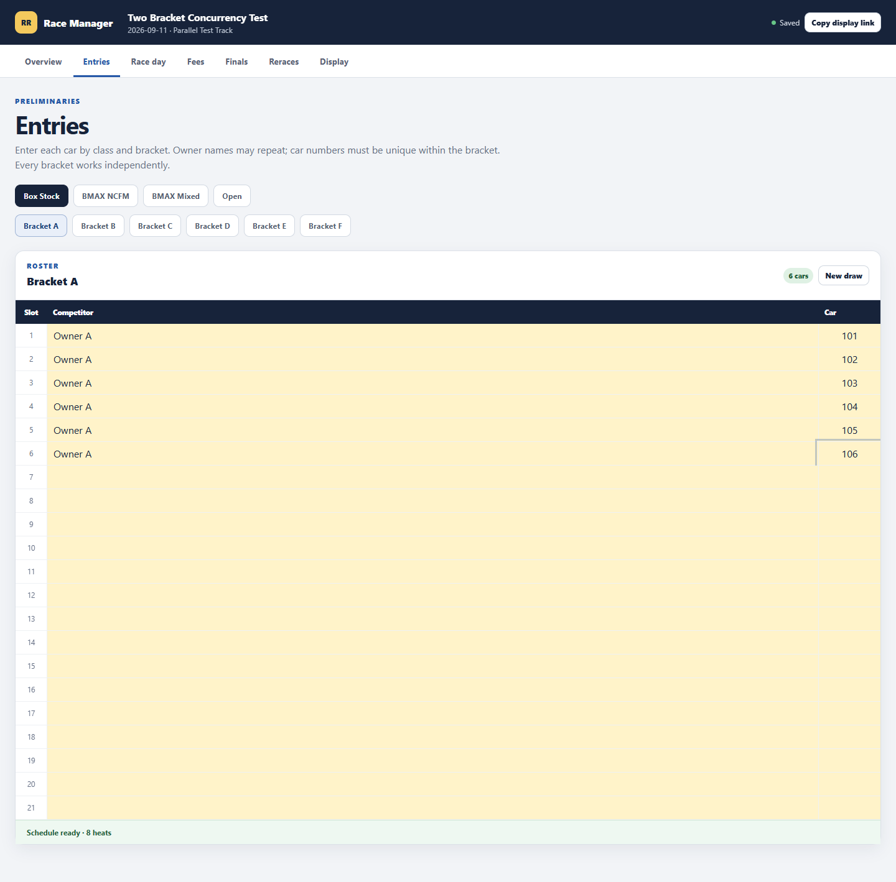
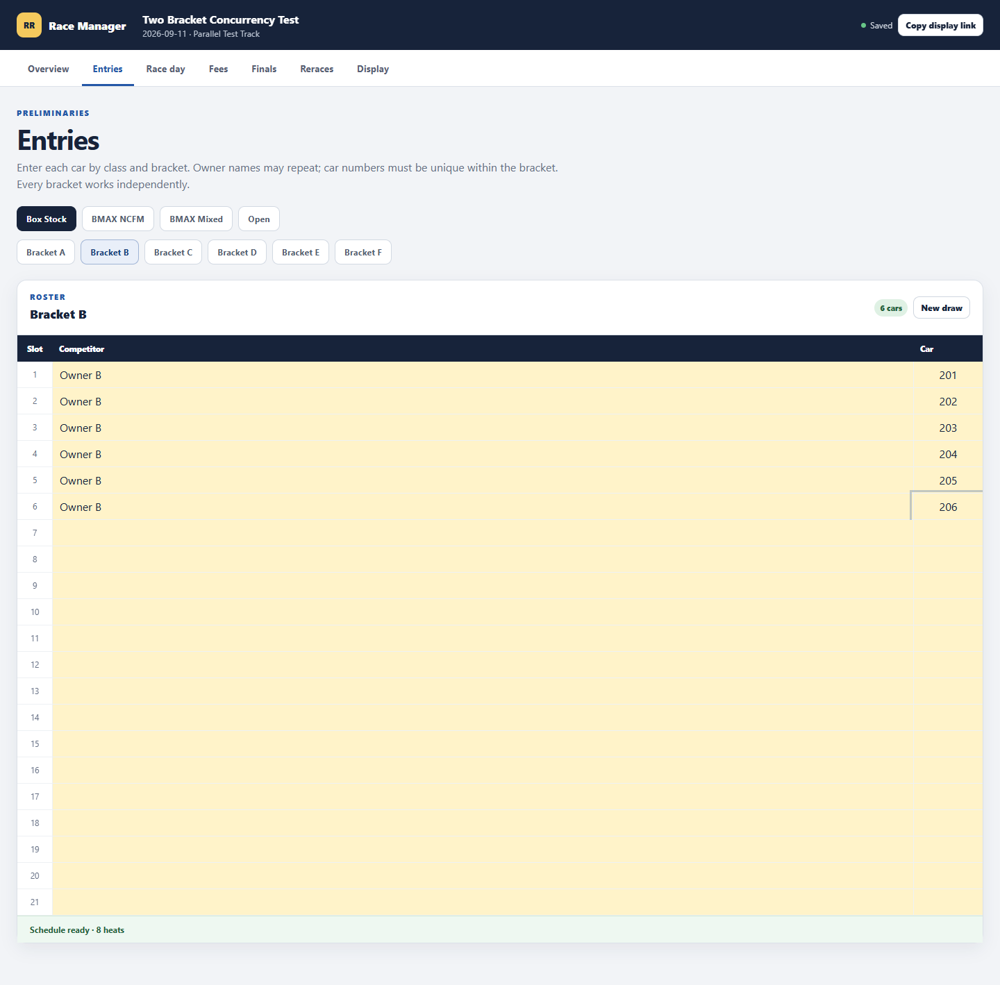
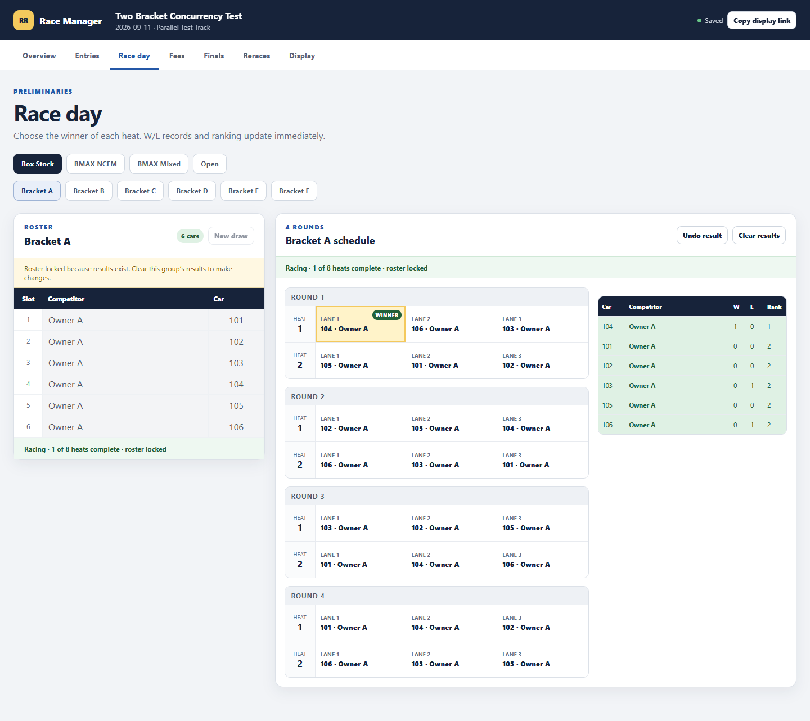
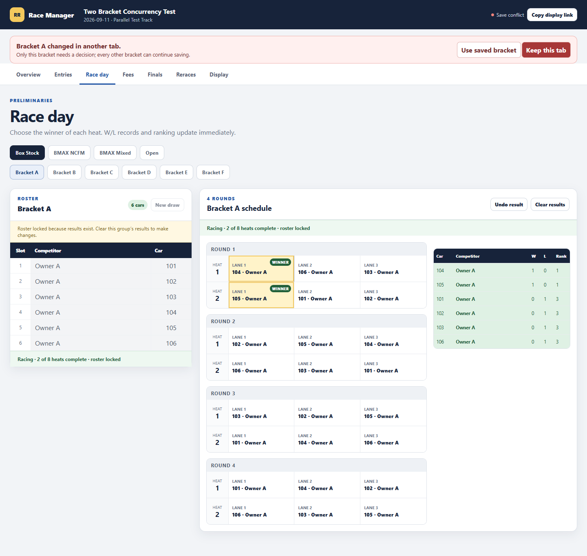

# Changelog

All production changes to Round Robin Race Manager are recorded here using semantic versioning.

## [1.1.0] — 2026-09-11

### Added

- Independent Netlify Blob records and revision counters for every preliminary, finals, and rerace bracket.
- A bracket-specific API route: `PUT /api/events/:id/groups/:groupId`.
- Atomic ETag-based conflict protection for concurrent writes to the same bracket.
- Three-second remote polling that merges changes from other brackets automatically.
- Scoped conflict controls: **Use saved bracket** and **Keep this tab**.
- Synchronization regression tests and a production concurrency E2E test.
- Permanent PRD, architecture, testing, project-context, and release-documentation files.

### Changed

- Dirty state and autosave are now tracked per bracket instead of once for the entire event.
- Event settings and payments save through their own metadata boundary.
- The saved-state indicator reports multiple pending bracket saves.
- Event reads hydrate the base event with every current independent group record.

### Fixed

- Bracket A can be created, scheduled, raced, and saved while Bracket B is empty.
- Bracket B can begin later without replacing completed Bracket A data.
- Two brackets can run in separate tabs/devices at the same time without lost rosters or results.
- A same-bracket collision can no longer overwrite the other operator silently.
- Legacy embedded schedules are reconciled into independent bracket records.

### Removed

- Removed whole-event persistence for bracket edits. Bracket edits now write only their own group record.
- No race-day feature was removed in this release.

### Validation

- 14 unit tests passed.
- Production build passed.
- Standard production desktop/mobile E2E passed with zero console errors.
- Production simultaneous-bracket E2E passed: Bracket A and B each retained six cars, revision 2, and one winner.
- Same-bracket collision checks returned one 200 and one 409 in both the UI and direct API tests.
- Unauthorised group update returned 401.
- Production deploy: `6aa37ded9b7335b5874031de`.

### Screenshots

Bracket A independently saved:

Bracket B independently saved:

Result retained after simultaneous operation:

Same-bracket conflict protected from data loss:

## [1.0.0] — 2026-09-10

### Added

- Initial hosted React/Vite race manager based on the verified Excel workflow.
- Four classes, six brackets, main racing, finals, reraces, rankings, W/L records, owner-based fees, backup/restore, CSV export, offline copy, private admin links, and read-only public links.
- Duplicate owner names supported while retaining unique car-number identity.
