# Changelog

All production changes to Round Robin Race Manager are recorded here using semantic versioning.

## [2.0.0] - 2026-11-20

### Added

- Organiser accounts with email verification, password reset, Google sign-in, and editable profile and scoring settings.
- Private event history, recovery of pending browser edits, and import of an older event using its private admin link.
- Confirm first, second and third place by category, and calculate season points from confirmed podiums.
- Race Control shows heats scored and brackets needing attention. Organisers can filter groups, open any bracket directly, and change the event status from the overview.

### Changed

- Event data and payments are scoped to the signed-in organiser. Explicit spectator links show race information and can be revoked.
- Pending edits are encrypted in the browser and can be reopened by the same account after sign-in.

### Validation

- 31 unit tests, production bundling, and desktop and mobile Race Control and browser recovery tests passed.
- Netlify preview `6affef0a1f3562d74c1bf82c` passed the standard and concurrency browser checks. Separate verified accounts confirmed that a second organiser gets 404 on the first organiser's event reads and writes.
- Signup email verification, password reset, sign-out and the Google authorization redirect were verified on the preview.

### Screenshots

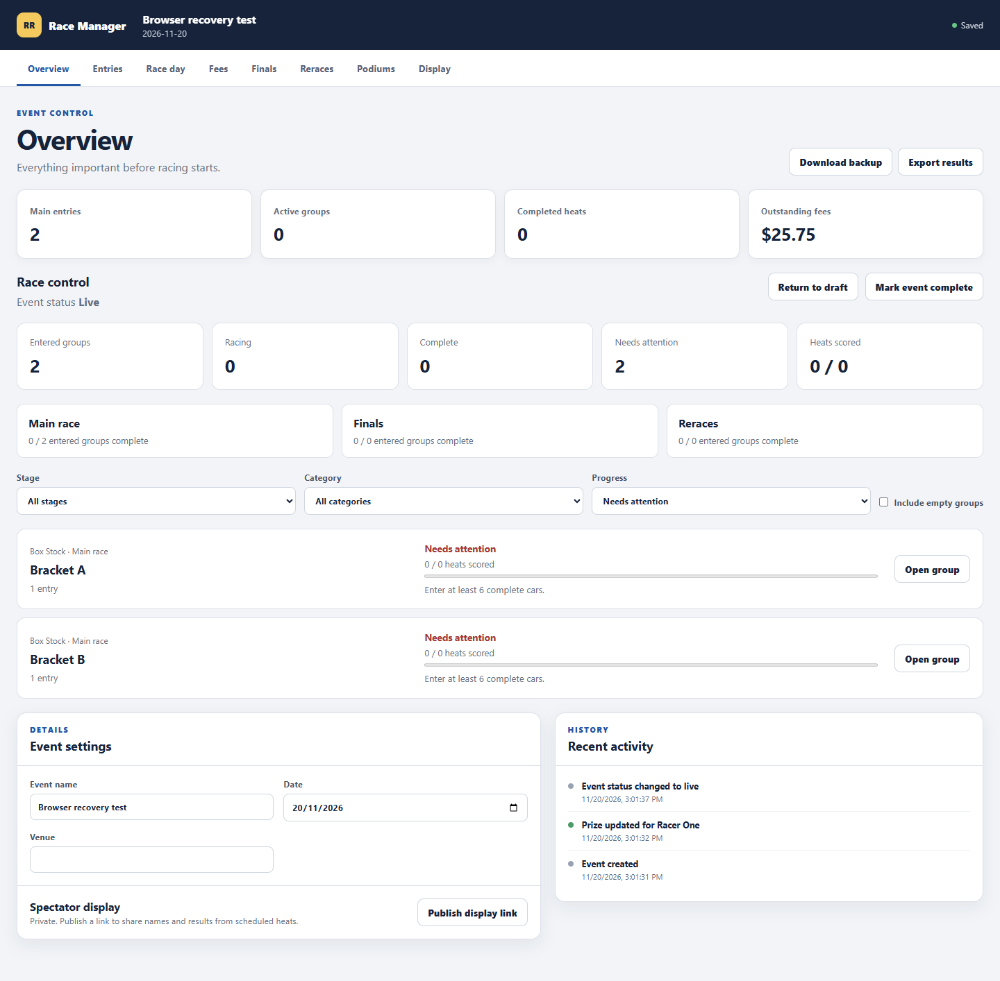

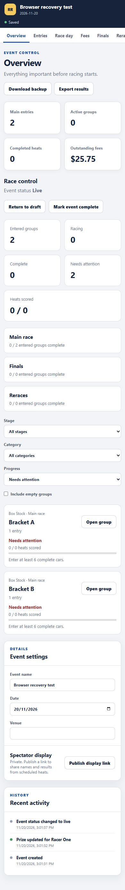

## [1.3.0] - 2026-11-20

### Added

- Reopen recent events from the home page in the same browser. Resume pending entries, results, and fee edits after closing the browser.
- Record prize credits between Total due and Paid. The balance subtracts each competitor's prize credit and payment, with a minimum of zero.
- Credit Ahsan Ali and AhsanTechLabs.com in the home page footer and identify the app as free to use.

### Validation

- All 16 unit tests and the TypeScript production build passed.
- Desktop and mobile E2E on production verified the footer, category fees, prize credits, and payments after reload.
- A production test closed the tab with roster and prize edits pending, then reopened from the home page without the admin link. Both edits synced to Netlify after recovery.
- The browser restart test verified recovery across a full browser close, preservation of independent bracket changes, and explicit conflict resolution for stale edits.
- Production concurrency E2E verified independent brackets, 200 and 409 for simultaneous same-bracket saves, and 401 for an unauthorised write.
- Production deploy `6affdfac03e057dd9d067388` came from main commit `e00a37557f627dc18ffe6c3766193466e51be8d1`. Live verification used test events.

### Screenshots

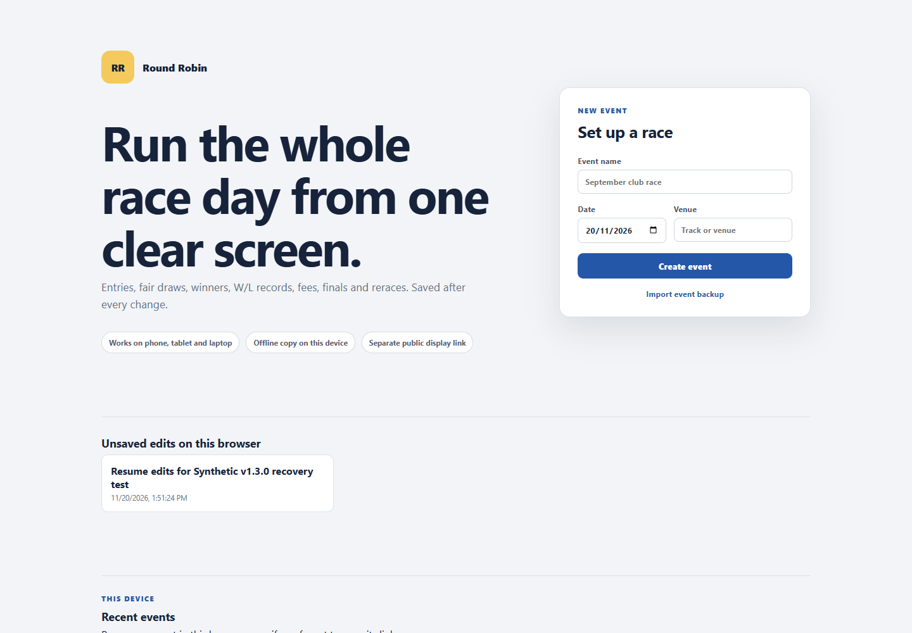

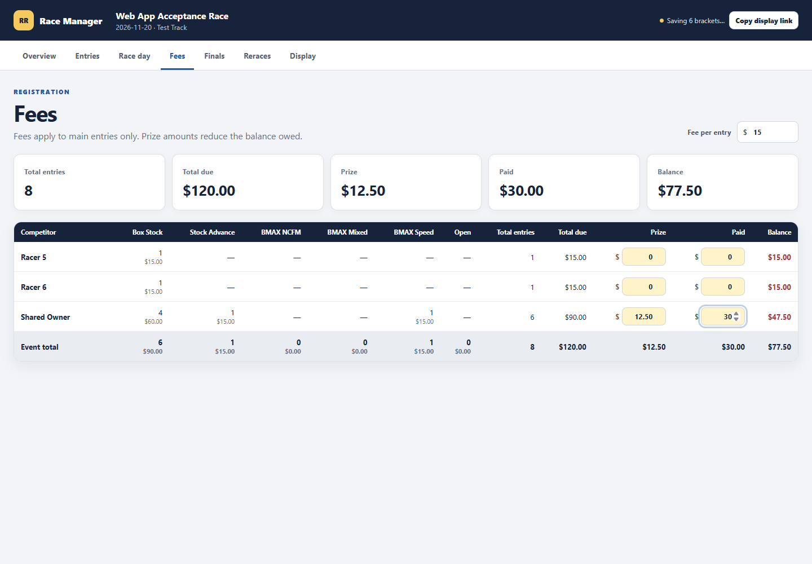

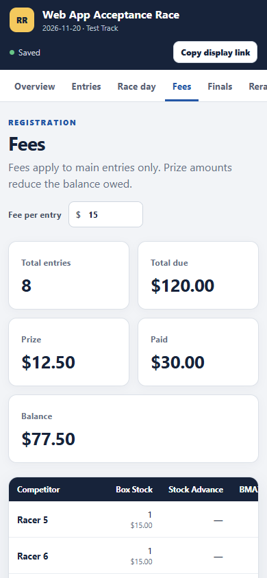

## [1.2.0] - 2026-11-20

### Added

- Added Stock Advance and BMAX Speed to main racing and finals. Older four-class events receive both classes while retaining their saved brackets and results.
- Added per-category entry counts and fees to each competitor's row, with total entries and fees for each competitor and for the event.

### Validation

- All 15 unit tests and the TypeScript production build passed.
- Desktop and mobile E2E on the permanent production URL verified that entries in both new categories and payments survive reload, category and event totals reconcile, and finals stay fee-free.
- The production concurrency test confirmed that independent brackets saved successfully, simultaneous saves to one bracket returned 200 and 409, and unauthorised writes returned 401. The seven-viewport standings regression passed.
- Production deploy: `6affcea20080643652bf0eee` from source commit `25ae745b06945c54fc7d5d5381e933684f3c6d96`. Live verification used test events.

### Screenshots

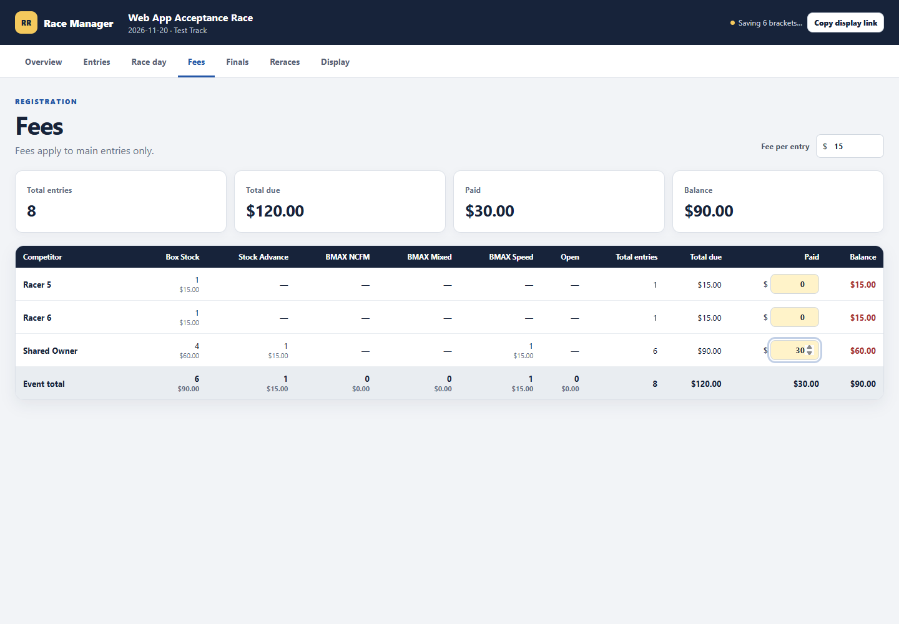

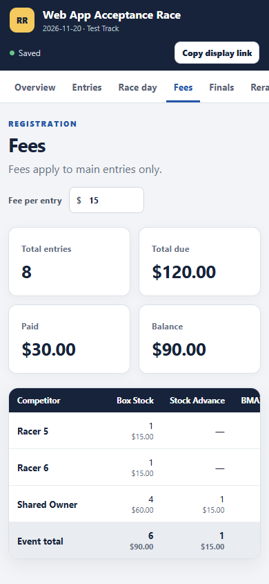

## [1.1.1] - 2026-11-12

### Fixed

- Keep live standings pinned beside the scoring rounds on desktop. The schedule panel no longer traps sticky positioning in a non-scrolling clipping container.
- Keep a compact, independently scrollable standings table above the rounds on phones and tablets, with an accessible collapse/expand control.
- Measure the sticky header and navigation so standings do not overlap them when the header wraps or in public display mode.
- Keep every competitor accessible on short screens, retain table headings while scrolling, and include the full standings when printing.

### Validation

- 14 domain and synchronization unit tests passed; TypeScript and production build passed.
- Isolated seven-viewport Chrome regression passed for pinning through the final round, all 21 competitors, score/clear updates, keyboard collapse/expand, printing, and unauthenticated public display.
- Standard local desktop/mobile E2E passed with zero browser errors. Desktop and mobile release screenshots were inspected.
- Preview and permanent production URL passed standings, standard desktop/mobile E2E, and deployed concurrency E2E, with zero browser errors. Atomic same-bracket writes returned 200/409; unauthorized writes returned 401.
- Production deploy: `6af54ff84554aa46f4382765`, from merged main commit `21e7cf9a9961ab334d24040e8b23cc7da2ad54cb`. Existing functions included; validation used isolated test events.

### Screenshots

Standings remain pinned while scoring the final round:

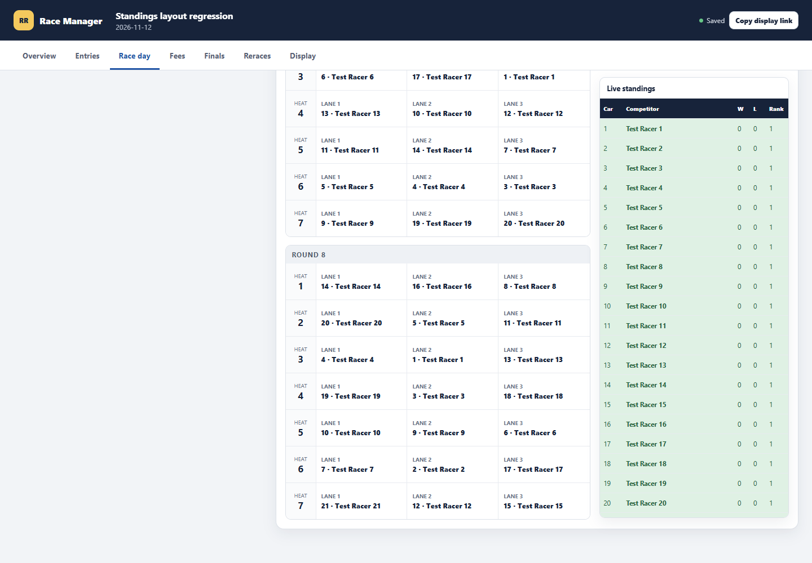

Compact standings remain visible above phone scoring controls:

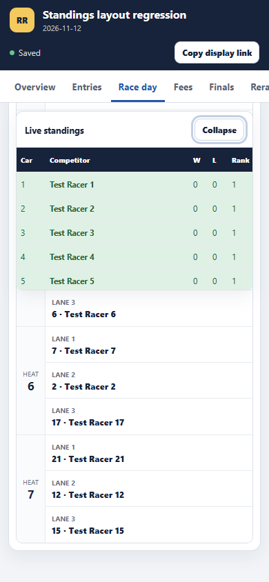

### Test tooling

- Browser tests accept `CHROME_PATH` and detect common Windows, macOS, and Linux Chrome installations.
- Concurrency screenshots use the package version, preserving earlier release evidence.

## [1.1.0] - 2026-09-11

### Added

- Independent Netlify Blob records and revision counters for every preliminary, finals, and rerace bracket.
- A bracket-specific API route: `PUT /api/events/:id/groups/:groupId`.
- Atomic ETag-based conflict protection for concurrent writes to the same bracket.
- Three-second remote polling that merges changes from other brackets automatically.
- Scoped conflict controls: **Use saved bracket** and **Keep this tab**.
- Synchronization regression tests and a production concurrency E2E test.
- Permanent PRD, architecture, testing, project-context, and release-documentation files.

### Changed

- Dirty state and autosave are now tracked per bracket instead of once for the entire event.
- Event settings and payments save through their own metadata boundary.
- The saved-state indicator reports multiple pending bracket saves.
- Event reads hydrate the base event with every current independent group record.

### Fixed

- Bracket A can be created, scheduled, raced, and saved while Bracket B is empty.
- Bracket B can begin later without replacing completed Bracket A data.
- Two brackets can run in separate tabs/devices at the same time without lost rosters or results.
- A same-bracket collision can no longer overwrite the other operator silently.
- Legacy embedded schedules are reconciled into independent bracket records.

### Removed

- Removed whole-event persistence for bracket edits. Bracket edits now write only their own group record.
- No race-day feature was removed in this release.

### Validation

- 14 unit tests passed.
- Production build passed.
- Standard production desktop/mobile E2E passed with zero console errors.
- Production simultaneous-bracket E2E passed: Bracket A and B each retained six cars, revision 2, and one winner.
- Same-bracket collision checks returned one 200 and one 409 in both the UI and direct API tests.
- Unauthorised group update returned 401.
- Production deploy: `6aa37ded9b7335b5874031de`.

### Screenshots

Bracket A independently saved:

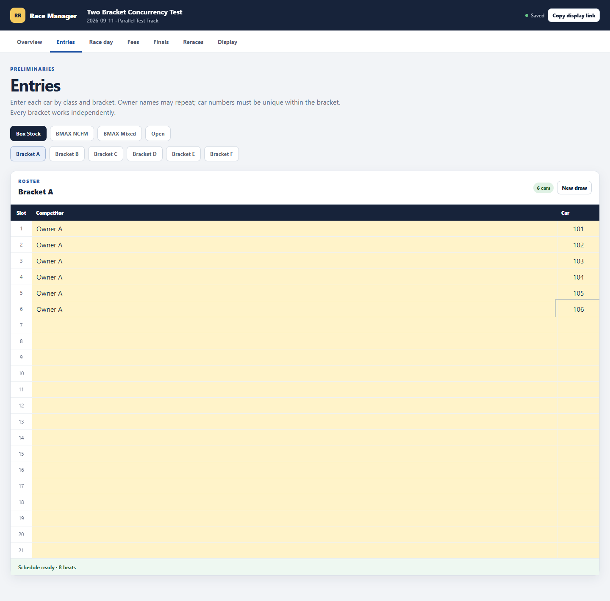

Bracket B independently saved:

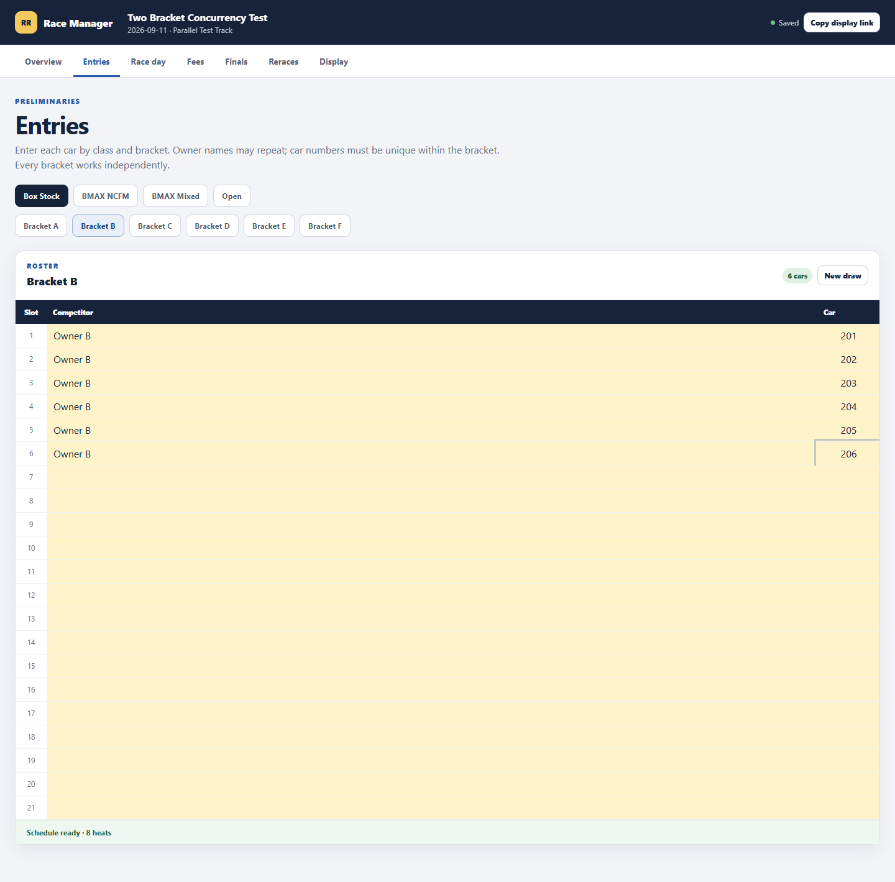

Result retained after simultaneous operation:

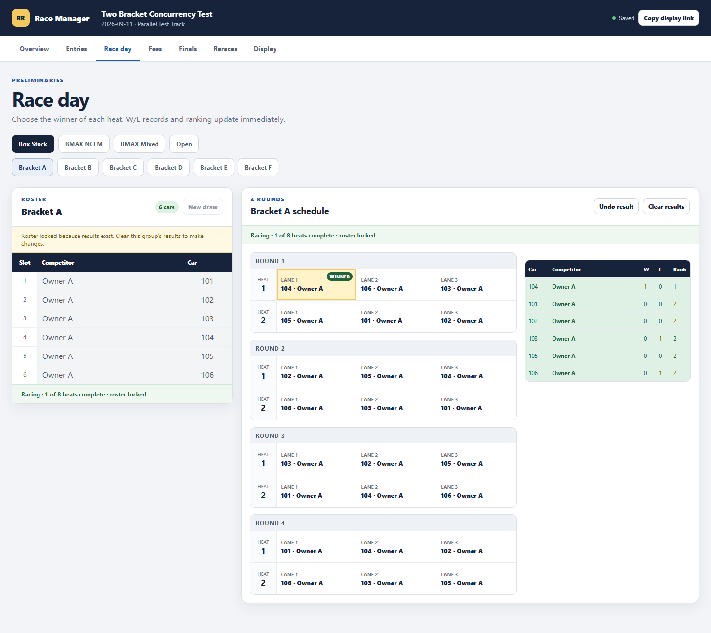

Same-bracket conflict protected from data loss:

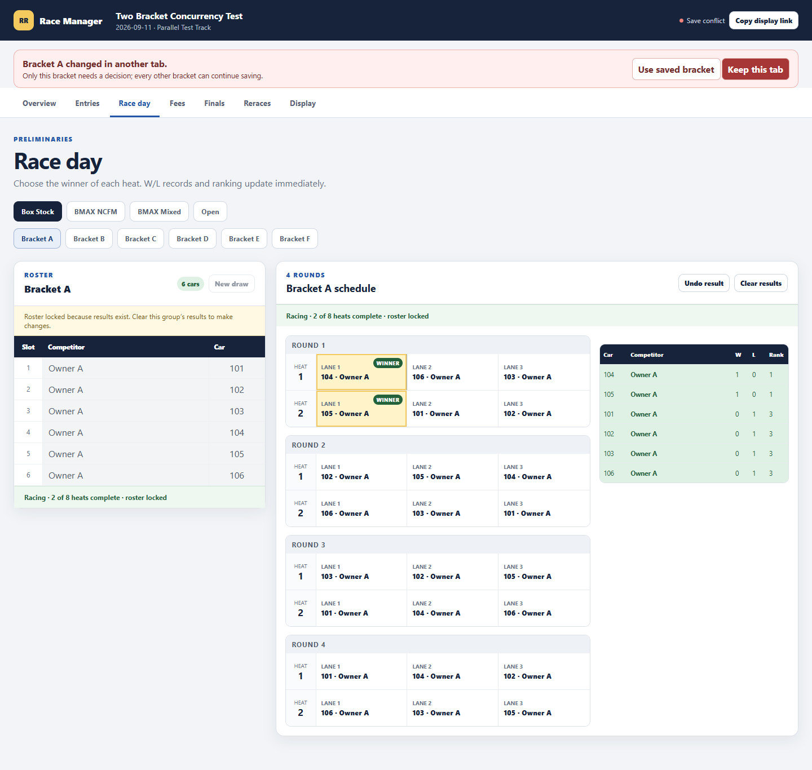

## [1.0.0] - 2026-09-10

### Added

- Initial hosted React/Vite race manager based on the verified Excel workflow.
- Four classes, six brackets, main racing, finals, reraces, rankings, W/L records, owner-based fees, backup/restore, CSV export, offline copy, private admin links, and read-only public links.
- Duplicate owner names supported while retaining unique car-number identity.

